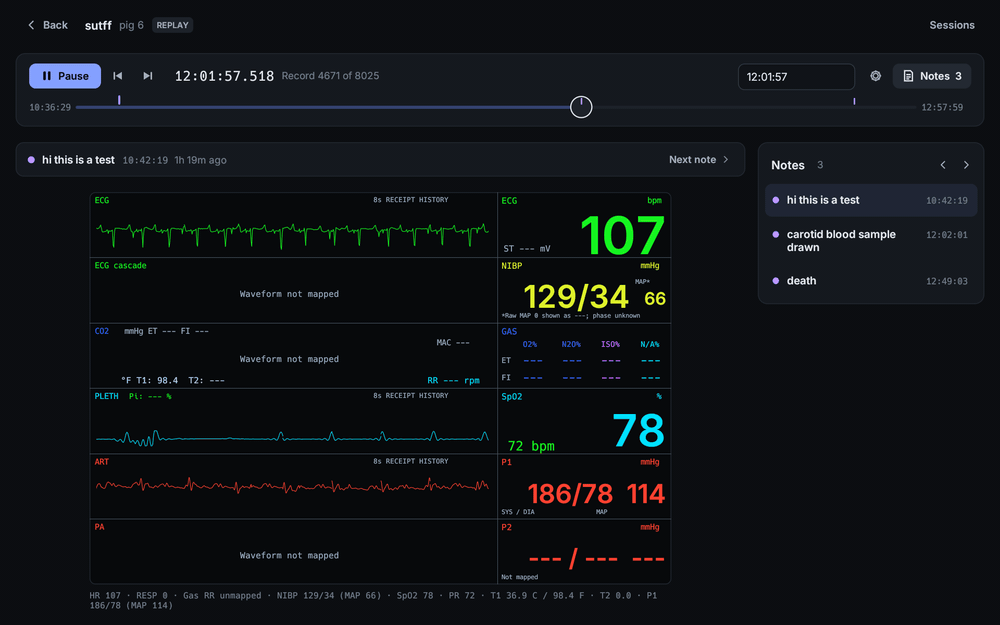
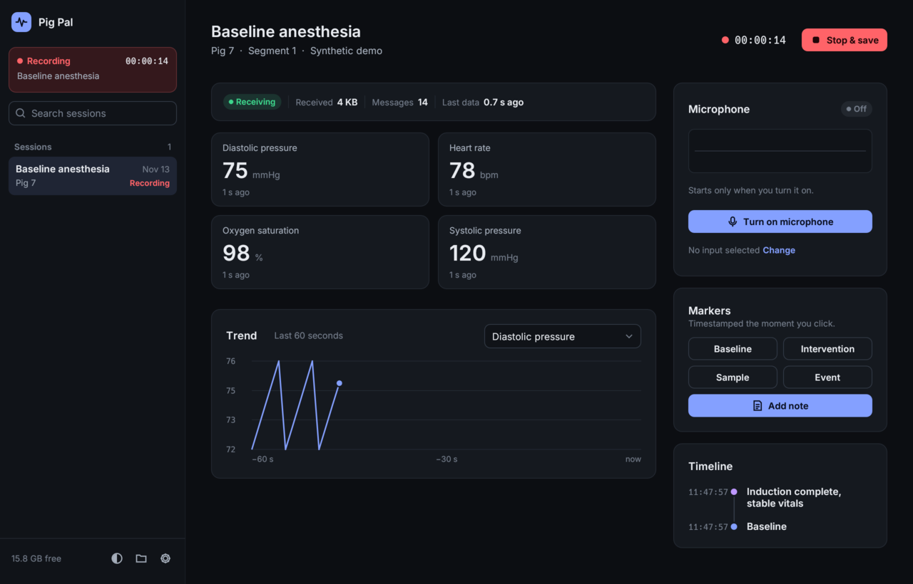
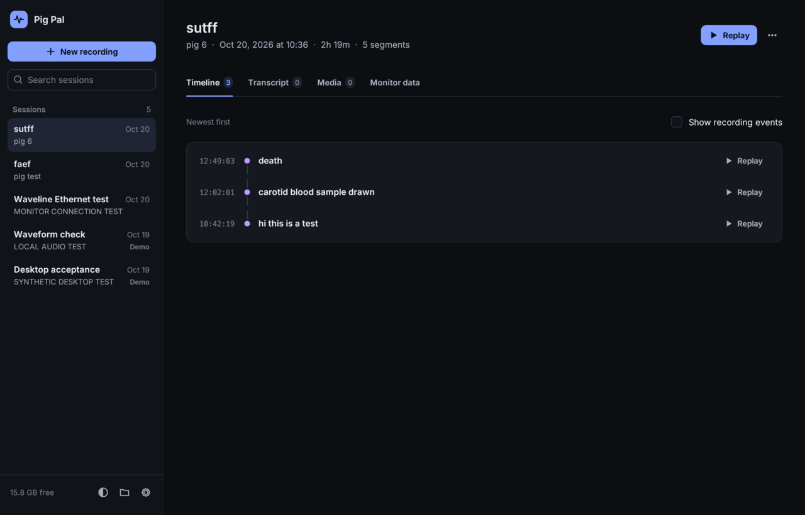
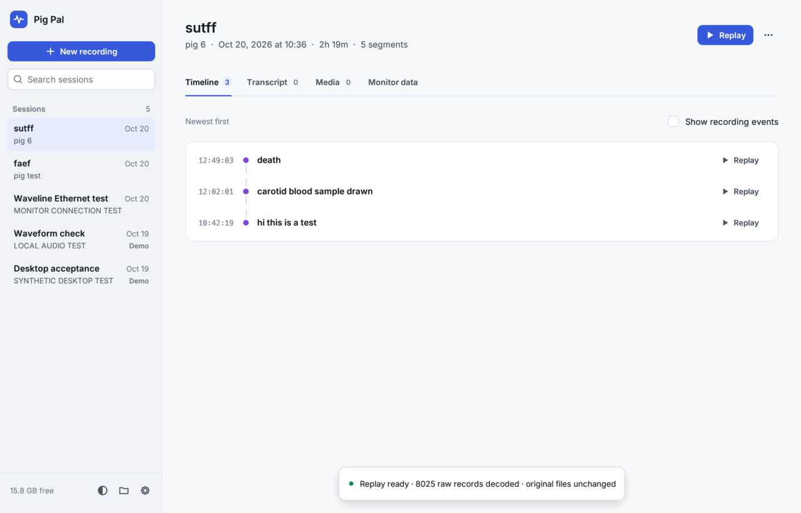

# Pig Pal

A Rust desktop app for the **Waveline Pro** patient monitor. Pig Pal receives
monitor data over Ethernet, displays decoded readings in a Waveline-style view,
and saves the complete incoming stream alongside timestamped CSVs.

<p align="center">
  
</p>
<p align="center"><sub>Replaying a saved session in the Waveline view. Notes taken during surgery appear on the timeline and jump the monitor to that moment.</sub></p>

- **Records everything:** raw monitor bytes, decoded vitals, notes, markers and
  optional microphone audio. Capture keeps running when the window is hidden,
  minimized or unfocused.
- **Waveline view:** a live layout modeled on the device screen, plus replay of
  any saved session with notes and markers on the timeline.
- **Local and offline:** data stays on the laptop; transcription runs offline.

| Live recording | Saved session | Light mode |
|---|---|---|
|  |  |  |

```text
Waveline Pro -- Ethernet / TCP --> Pig Pal
                                   |-- live monitor view
                                   `-- raw bytes + CSV exports
```

Numeric decoding is experimental. See the [decoder notes](docs/WAVELINE_DECODER.md)
for supported fields and verification limits; waveform candidates remain uncalibrated.

## Ethernet byte map

The tested monitor initiates **TCP** to Pig Pal at `10.0.0.2:12345` from
`10.0.0.3`. Its observed **A.3.02 proprietary binary format** uses 1,956-byte
records; this is a partial reverse engineering, without a vendor specification.
Offsets below are **zero-based bytes from the record start**, with inclusive
ranges. `LE` means little-endian; TCP reads may contain partial or multiple records.

| Bytes | Encoding | Reading / meaning | Units / status |
|---|---|---|---|
| 0–3 | fixed `01 02 5b f6` | Record signature | Observed framing |
| 4–7 | u32 LE | Record length = 1,956 | Bytes |
| 14–15 | u16 LE | ECG heart rate | bpm; photo-supported |
| 20–21 | u16 LE | Respiration candidate | Tentative; differs from gas RR |
| 28–29 / 30–31 / 32–33 | 3 × u16 LE | Cuff SYS / DIA / MAP | mmHg; MAP can be zero during a cuff cycle |
| 36–39 / 40–43 / 44–47 | 3 × i32 LE | P1 arterial SYS / DIA / MAP | mmHg; photo-supported, validity incomplete |
| 48–51 / 52–55 / 56–59 | 3 × i32 LE | P2 SYS / DIA / MAP candidate | No active-channel reference yet |
| 64–65 | u16 LE | SpO₂ | %; photo-supported |
| 66–67 | u16 LE | Pulse rate | bpm; photo-supported |
| 68–71 | f32 LE | Temperature 1 | °C; display °F = °C × 1.8 + 32 |
| 72–75 | f32 LE | Temperature 2 candidate | Unconfirmed |
| 89 / 349 / 417 / 661 / 797 | u8 each | ECG / pleth / RESP / P1 / P2 state bytes | Raw flags; meanings only partly identified |
| 180–251 | 72 × u8 | ECG waveform candidate | Raw 0–255; mV calibration unresolved |
| 356–415 | 60 × u8 | Pleth waveform candidate | Raw 0–255; calibration unresolved |
| 424–551 | 128 × u8 | RESP waveform candidate | Tentative; not confirmed CO₂ |
| 664–667 / 800–803 | u32 LE each | P1 / P2 range candidates, both 150 | Match photo axis labels; unverified schema |
| 668–795 | 128 × u8 | P1 arterial waveform candidate | Raw 0–255; mmHg scaling unresolved |
| 804–931 | 128 × u8 | P2 waveform region candidate | Flat/inactive in saved references |
| Unknown | Unknown | ET/FI CO₂, O₂, N₂O, ISO, MAC and gas RR | **Not decoded** |

Raw zeros and possible sentinel values need channel-state interpretation; a fresh
record does not prove every channel is reading. CSV timestamps are **host receipt
times**, separate from these bytes—not decoded monitor/sample timestamps. See
[decoder notes](docs/WAVELINE_DECODER.md) for evidence, missing-data behavior and limits.

## Build and run

On macOS, install **Rust 1.88+** and the **Xcode command-line tools**, then run
from the repository root:

```sh
cargo run --release --locked
```

For a packaged app, optional audio transcription, or Windows/Linux setup, see
[Building Pig Pal](docs/BUILDING.md). Python is only used by the build and
packaging scripts; the packaged app does not require it.

## Connect the monitor

1. Connect the computer and Waveline Pro to the same Ethernet network.
2. In **Settings → Connection**, choose **TCP listener** with generic HL7 decoding
   and application ACKs off. The tested setup listens on `10.0.0.2:12345` for
   monitor `10.0.0.3`; use the addresses configured for your network and monitor.
3. Start a session and enable **Waveline monitor view**. Use **Copy live CSV path**
   to watch incoming rows, then **Stop & save** to review or export the session.

## CSV data and waveform samples

Each roughly one-second record contains one numeric value per vital plus **72 ECG,
60 pleth, 128 respiration, and 128 P1 raw waveform values**. HR in bpm is separate
from the ECG trace. These block lengths are confirmed; hardware sampling rates
and waveform amplitude calibration remain unresolved.

New `waveline_live.csv` files include every sample in four ordered JSON-array
columns. Saved exports add `waveline_readings.csv` (vitals plus sample arrays) and
`waveline_waveforms.csv` (one row per sample, linked by `record_id`). No waveform
samples are averaged away. CSV names omit the old `candidate` suffix;
`mapping_verified=false` retains the decoder status.

For separate exports from a historical session, use a **new output directory**:

```sh
cargo run --release --locked -- --export-waveline /path/to/session --output-dir /path/to/new-export
```

Receipt timestamps belong to whole records. Sample indices retain within-block
order; they are not exact acquisition timestamps. Rates calculated from receipt
intervals are explicitly estimates. See [CSV details](docs/USAGE.md).

## More details

- [Recording, exports, and storage](docs/USAGE.md)
- [Ethernet decoding](docs/WAVELINE_DECODER.md) and [validation results](docs/VALIDATION.md)
- [Dependency licenses](THIRD_PARTY.md)
